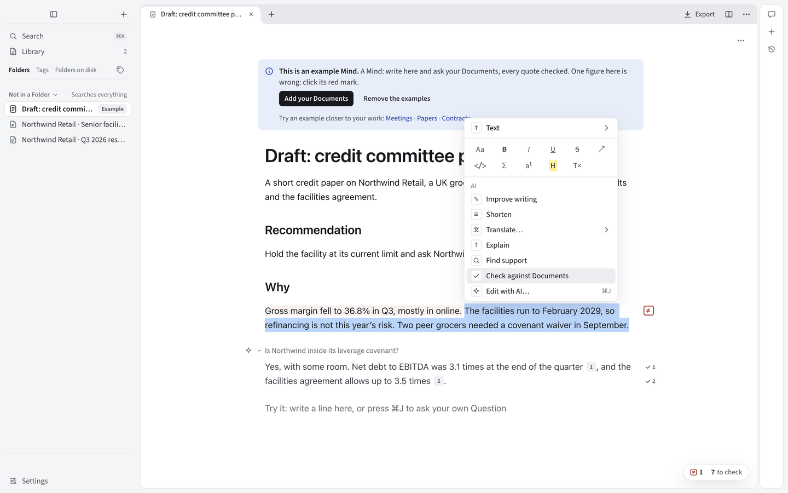

<!-- README.md 与 README.zh-CN.md 逐节对应，修改时请两份一起改。 -->

<p align="center"><a href="README.md">English</a> · <b>简体中文</b></p>

<h1 align="center">IncarnaMind</h1>

<p align="center">
  <b>会自己核对引文的 AI 笔记本。</b><br>
  写作和提问在同一个地方，回答来自你自己的文件和你选的 AI 模型。免费开源，在你自己的电脑上运行。
</p>

<p align="center"><a href="https://tally.so/r/LZA5aG?ref=readme-zh"></a></p>

<p align="center">
  <a href="#下载"><b>下载</b></a> ·
  <a href="#你能用它做什么">你能用它做什么</a> ·
  <a href="#你的文件始终归你">隐私</a> ·
  <a href="https://github.com/IncarnaMind/IncarnaMind/discussions">讨论区</a>
  <br><br>
  
  <a href="LICENSE"></a>
  <!-- 第一个版本发布后，加上：<a href="https://github.com/IncarnaMind/IncarnaMind/releases/latest"></a> -->
</p>

<p align="center"></p>

<p align="center"><sub>图中展示的功能现在都能用。</sub></p>

**IncarnaMind** 是一款免费开源的桌面应用，支持 macOS、Windows 和 Linux：你可以就自己的文档（PDF、Word、PowerPoint、Excel 等）提问，并借助 AI 写作。每个回答都标明出处的确切页码，IncarnaMind 会核对每段引文确实在那里。它可以使用你自己的 API 密钥、通过 Ollama 运行的本地模型，或你的 ChatGPT 订阅。

## 下载

**IncarnaMind 还没有正式发布。** 发布后，[发布页](https://github.com/IncarnaMind/IncarnaMind/releases)会提供 macOS（Apple 芯片和 Intel）、Windows 和 Linux 的安装包。想在发布时收到通知，可以[留下邮箱](https://tally.so/r/LZA5aG?ref=readme-zh)，或点本页右上角的 **Watch → Custom → Releases**。想现在试用，可以用 Node.js 24 或更高版本从源码运行：

```shell
git clone https://github.com/IncarnaMind/IncarnaMind.git && cd IncarnaMind
npm install && npm run dev
```

Windows 版将通过 SignPath Foundation 为开源项目提供的免费签名服务签名，在此之前安装程序暂未签名。见[代码签名政策（Code signing policy）](docs/code-signing-policy.md)。

<details>
<summary>系统不让打开时</summary>

- **Windows** 提示“Windows 已保护你的电脑”：安装程序暂时还没有代码签名。点**更多信息**，再点**仍要运行**。
- **macOS** 提示无法验证 IncarnaMind：在完成公证之前，先打开一次，在警告里点**完成**，再到**系统设置 → 隐私与安全性**里点**仍要打开**。也可以运行 `xattr -dr com.apple.quarantine /Applications/IncarnaMind.app`。未签名的 Mac 版不能自动更新：有新版本时，IncarnaMind 会通知你，并打开下载页面。
- **Linux**：先运行 `chmod +x IncarnaMind-*.AppImage`。Ubuntu 22.04 及以后的版本还要运行 `sudo apt install libfuse2`（24.04 及以后是 `libfuse2t64`）。

</details>

## 你能用它做什么

**交稿前先核对一遍。** 在 Mind 里选中几句话，选择 **对照文档核对**：每句话都会标出在你的文档里有依据、无依据还是与文档矛盾，原文一键打开，标题下还会统计还有几处需要留意。别人写的 PDF 也能这样逐条核对说法：**+ → 核对文档…**。

**边写边问。** 一个 Mind 就是为一个主题准备的笔记本，旁边就是助手：就当前的 Mind 或你的文件向它提问，回答以对话的形式留在助手里，每个引用都已核对。你的草稿保持原样，直到你点 **添加到笔记**：回答连同引用放到光标处，可以像普通文字一样修改。

**每个回答都能核对。** 回答会标出每个说法的出处，并附上原文引文，再逐条到那个位置核对：找到了打绿勾，没找到就标成橙色；点一下，原文就打开到那一页，引文高亮显示。展开回答的过程，可以看到它搜了什么、用了哪些来源。

**会议中记笔记。** 开始录音后，实时转写显示在 Mind 旁边，转写在你的电脑上完成。会议结束后，可以把转写稿保存为文档，笔记就能引用会上说过的话。

**直接用你手上的文件。** 把你平时用的文件夹添加为同步文件夹，连 Zotero 的存储文件夹也可以：IncarnaMind 就地读取里面的 PDF、Word（连批注一起）、PowerPoint、Excel、CSV、Markdown 和纯文本文件，从不移动或修改它们，文件有变化也会跟着更新。

**查找和添加资料。** 在 OpenAlex、arXiv 和 PubMed 里搜索论文，开放获取的直接添加为文档；输入网址保存网页，像文件一样引用和核对；还能从 Zotero 或任何 CSL JSON、BibTeX、RIS 文件导入引用信息。

**AI 帮你写，改不改由你定。** 选中文字，选“用 AI 编辑…”，改动以修订的形式回来，由你接受或拒绝。开启写作建议后，你停下来时会出现灰色的续写，只在你的文档支持时出现，并且总带着引用；按 Tab 采纳。

**文档再多也不乱。** 标签会自动添加，IncarnaMind 还会给每个文档推荐文件夹，由你确认；你自己做的选择都会保留。

**模型由你来选。** 可以用你自己的 OpenAI、Anthropic、Google、DeepSeek、通义千问、硅基流动、OpenRouter 密钥，还有更多可选，例如 Kimi、智谱 GLM、Mistral、xAI，或任何兼容 OpenAI 接口的服务；也可以通过 Ollama 使用免费的本地模型，内容不出你的电脑。已经订阅了 ChatGPT Plus 或 Pro，也可以使用 ChatGPT 登录，直接用订阅提问。

**在你已经在用的 AI 智能体里提问**（实验功能，默认关闭）。在**设置 → 智能体**里连接 Claude、Codex、Cursor 等，用的是它们自己的订阅：它们只能读你选定的文件夹，从 IncarnaMind 拿到的每条引文都经过核对；它们读到的内容会按其服务条款发给它们的 AI 服务。[各个智能体的连接方法](docs/agents.zh-CN.md)。

**写完就能交。** 把 Mind 导出为 Word 或 Markdown，引用和参考文献按你选的引用格式排好：APA、MLA、Chicago、Harvard、IEEE、Vancouver、GB/T 7714，或 IncarnaMind 自己的编号格式。没通过核对的引用会标上“[未核实]”。也可以把 Word 文件打开成 Mind，再导出回同一个文件：没改动的部分原样保留，你的修改可以作为修订写回去。

**用表格对比文档。** **对比文档…** 会向你选的每个文件提出同样的问题，填成一张表，每一格都是带引用、经过核对的回答。

**连接应用和技能，运行前先问你。** 添加连接器（MCP 服务器），或者直接导入你在 Claude Desktop、Cursor 里配置好的；也可以添加技能（标准的 `SKILL.md` 文件夹），内置三个。可能改动内容的工具和技能里的脚本，都要你同意后才会运行。

**中英双语。** 整个界面都有中文和英文。

## 你的文件始终归你

不用注册账号，也没有 IncarnaMind 服务器。你的 Mind 和搜索索引都存在你电脑上的一个数据文件夹里，你的文件原样留在原处。你的问题和为它找到的段落只发给你选的模型，用本地模型时哪儿也不去。API 密钥用系统自带的安全存储加密保存。使用数据只有在你同意后才收集，是[匿名事件](docs/privacy.md#usage-data)，绝不包括你的文件或问题，随时可以在**设置 → 隐私**中关闭。崩溃报告默认关闭，开启后也会先去掉你的内容。

- **发送之前先问你。** IncarnaMind 第一次要把内容发给外部服务之前，会先告诉你要发什么、发给谁，等你同意后才发送。**设置 → 隐私**里列出了每一项，随时可以撤回。
- **要求提供商不保存。** 只要提供商给出这个选项，IncarnaMind 都会要求它不要保存你的请求；发给 OpenAI 和 xAI 的每个请求都带着这个要求，发给 OpenRouter 的请求则要求它只使用不保存、不训练的提供商。
- **运行什么，由你说了算。** 连接器里可能改动内容的工具，以及技能里的脚本，在运行之前 IncarnaMind 都会先问你：允许这一次、始终允许，或者拒绝。**设置 → 隐私**里列出了你设过的每条规则，随时可以撤销。

<details>
<summary><b>常见问题</b></summary>

- **要花钱吗？** 不用。IncarnaMind 开源免费（Apache 2.0 许可证）。用云端模型时，按用量付费给模型提供商；用本地模型则完全免费。
- **一定要有 API 密钥吗？** 不一定。只要 [Ollama](https://ollama.com) 在运行，IncarnaMind 一键就能下载本地模型。也可以填 OpenAI、Anthropic、Google、DeepSeek、通义千问、硅基流动、OpenRouter 的密钥；“设置”中还有更多提供商，例如 Kimi、智谱 GLM、Mistral、xAI，或任何兼容 OpenAI 接口的服务。订阅了 ChatGPT Plus 或 Pro，可以使用 ChatGPT 登录；订阅了 Claude，可以在**设置 → 智能体**里连接 Claude 应用（实验功能），在 Claude 里问你的文档。
- **是 NotebookLM（现名 Gemini Notebook）的替代品吗？** 是。IncarnaMind 在你的电脑上运行，文件始终留在本地；模型由你来选（你自己的密钥、ChatGPT 订阅，或通过 Ollama 运行的本地模型）；每条引用都和原文所在页逐一核对；Mind 还能导出为带引用的 Word。
- **能用我的 ChatGPT 订阅吗？** 能，需要 ChatGPT Plus 或 Pro。在**设置 → 模型**里选**使用 ChatGPT 继续**，在浏览器里完成登录即可：之后的提问会以你的账号发给 OpenAI，计入订阅的用量上限，不需要密钥。
- **能离线用吗？** 能，配合通过 Ollama 运行的本地模型：读取文件、搜索和引用核对都在你的电脑上完成。云端模型需要联网。按含义搜索（嵌入）是可选功能，默认关闭。
- **会改动我的文件吗？** 不会。它只在原处读取文件，只往自己的数据文件夹和你导出的文件里写内容。
- **“找到引文”是什么意思？** 意思是这段文字确实在引用所指的位置，但不代表它能证明你写的那句话，所以原文永远只差一次点击。“无法核对”表示那里没有可以比对的文字，比如扫描页。
- **怎么备份？** 复制数据文件夹就行，里面有你的 Mind、搜索索引和设置。

</details>

## 即将推出

下面是计划中的功能，现在还不能用，也没有具体日期（见[路线图](https://github.com/IncarnaMind/IncarnaMind/issues/74)）：会议进行中直接提问，回答引用实时转写；助手直接修改你的 Mind，每处修改都等你接受；在审阅栏里逐条查看别人在 Word 文件里的修订；在后台运行的研究任务。

## 参与贡献

欢迎写代码、用你自己的文档测试、翻译和提想法：先读 [CONTRIBUTING.md](CONTRIBUTING.md)（英文），也可以[提交 issue](https://github.com/IncarnaMind/IncarnaMind/issues/new/choose)，或到[讨论区](https://github.com/IncarnaMind/IncarnaMind/discussions)提问（中文、英文都可以）。

## 项目由来

IncarnaMind 最早是 2023 年的一个 Python 命令行工具，用来和 PDF 对话，收获了大约 800 个 star；2026 年从头重写成桌面应用，核心只有一个想法：从文件里得到的回答，能核对才真正有用。旧版命令行工具保留在 [`v1-python-cli`](https://github.com/IncarnaMind/IncarnaMind/tree/v1-python-cli) 标签下。谢谢一直关注它的你；如果 IncarnaMind 对你有用，点个 star，能让更多人看到它。

<details>
<summary>引用 IncarnaMind</summary>

```bibtex
@misc{IncarnaMind2023, author = {Junru Xiong}, title = {IncarnaMind}, year = {2023},
  publisher = {GitHub}, journal = {GitHub Repository},
  howpublished = {\url{https://github.com/IncarnaMind/IncarnaMind}}}
```

</details>

## 许可证

[Apache License 2.0](LICENSE)。应用内置的字体（Source Serif 4、Source Sans 3 和 JetBrains Mono）采用 [SIL Open Font License 1.1](https://openfontlicense.org)。引用格式和语言文件原样取自 [Citation Style Language](https://citationstyles.org/) 项目，采用 [CC BY-SA 3.0](https://creativecommons.org/licenses/by-sa/3.0/)；排版引擎是 [Hayagriva](https://github.com/typst/hayagriva)（MIT 或 Apache-2.0）。相关声明见 [`resources/notices`](resources/notices)。
