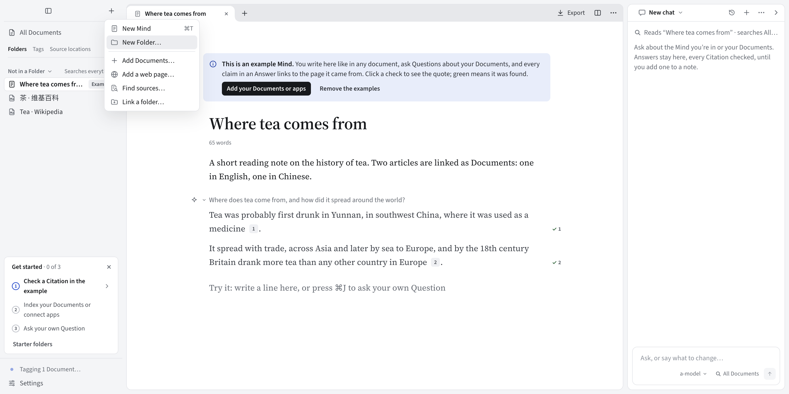
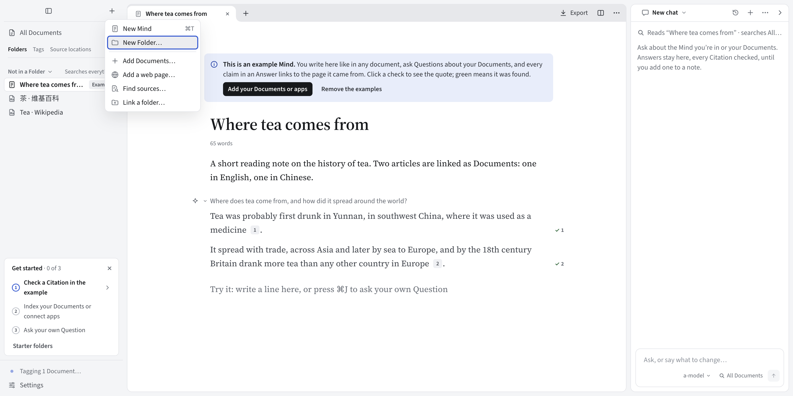
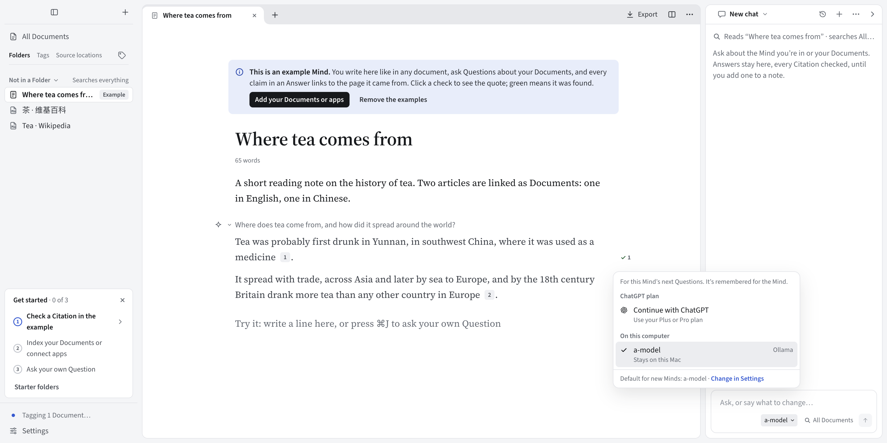
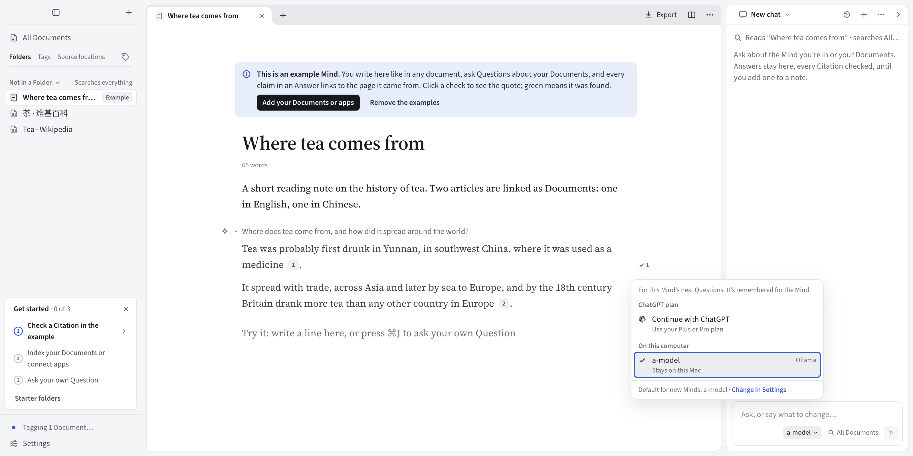

# Menu focus: #157

Keyboard focus in the sidebar menu and model picker, captured in the built Electron app on macOS. The examples are shipped test data; HOME and the data folder are temporary. Before uses the production styles from `ffda02af`; after uses the repaired styles. Both use the same regression and wait for motion to settle.

The design reference is the existing global `:focus-visible` rule: a solid 2px accent outline. Menu rows place it 2px inside their bounds to avoid clipping. The model menu's Settings link keeps the global outside offset. No layout board changes apply to this focus-state repair.

| Surface | Before | After |
| --- | --- | --- |
| Sidebar, English, 1600px |  |  |
| Sidebar, Chinese, 900px |  |  |
| Model picker, English, 1600px |  |  |
| Model picker, Chinese, 900px |  |  |

The focus outline is the intended difference. Background indexing can change its progress line between captures. The inherited typography is outside this repair (tracked in #400).

`e2e/focus.spec.ts` checks the ring when each menu opens and after ArrowDown moves focus, then checks Escape returns focus to the trigger. It also captures the Settings link. Both new scenarios fail on the baseline styles and pass with the repair.
